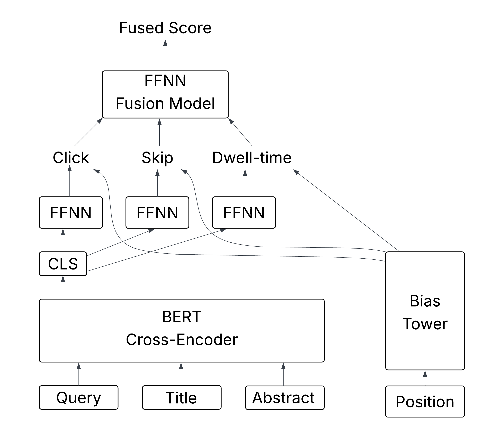

# Pretrained Multi-Feedback Cross-Encoders for Baidu-ULTR

This repository provides pretrained cross-encoder ranking models, training recipes, evaluation code, and fusion baselines for the Baidu-ULTR dataset.

The resource investigates how the choice of behavioral supervision affects neural base rankers trained on Baidu-ULTR. In addition to the standard click signal, the released models use skip and dwell-time feedback already available in the dataset.

This repository accompanies our ECIR 2027 Resource Track submission and is intended to provide reusable neural baselines for future research on Baidu-ULTR.

## Released Resources

The pretrained models and prepared training data are available on Hugging Face:

- 🤗 [Pretrained multi-feedback cross-encoders](https://huggingface.co/hamidahmadi/baidu-ultr-multi-feedback-cross-encoders)
- 🤗 [Prepared Baidu-ULTR pretraining data](https://huggingface.co/datasets/philipphager/baidu-ultr-pretrain)

We release five pretrained cross-encoder checkpoints:

| Variant | Feedback | Position debiasing | Training steps |
| --- | --- | --- | ---: |
| `click-only` | Click | Shared | 125K |
| `no-position-debiasing` | Click + Skip + Dwell time | None | 125K |
| `per-task-position-debiasing` | Click + Skip + Dwell time | Per-task | 125K |
| `shared-position-debiasing-125k` | Click + Skip + Dwell time | Shared | 125K |
| `shared-position-debiasing-2m` | Click + Skip + Dwell time | Shared | 2M |

All models are trained using the same 125 Baidu-ULTR training partitions. The `125k` and `2m` designations refer to the number of gradient updates, not the amount of training data.

## Overview

The models use a BERT-based cross-encoder to encode query-document pairs and predict behavioral feedback.

The multi-feedback variants jointly learn from:

- clicks;
- skips; and
- dwell time.

Position-dependent effects can additionally be modeled through a bias tower. The released models include variants without position debiasing, with a shared bias model, and with separate task-specific bias models.

For final ranking, the predicted behavioral signals can be combined using a small MLP fusion model.



## Dataset

This resource is based on Baidu-ULTR, a large-scale dataset for unbiased learning to rank containing search interactions, multiple forms of behavioral feedback, and a separate expert-annotated relevance set.

The original Baidu-ULTR dataset is not redistributed in this repository and remains subject to its original distribution and licensing terms.

The prepared pretraining data used by this resource are available through the [Baidu-ULTR pretraining dataset on Hugging Face](https://huggingface.co/datasets/philipphager/baidu-ultr-pretrain).

The experiments in this resource use the first 125 Baidu-ULTR training partitions. All released checkpoints, including the 2M-step model, use these same partitions.

## Repository Structure

```text
.
├── LICENSE
├── README.md
├── environment.yml
├── examples/
│   └── inference.py
├── images/
│   └── model-architecture-multi-task-bert.png
└── src/
    ├── bias_estimation.py
    ├── check_compatibility.py
    ├── const.py
    ├── data.py
    ├── evaluate_predictions.py
    ├── generate_predictions.py
    ├── load_model.py
    ├── model.py
    ├── multi_task_fuse.py
    ├── ranking_metrics.py
    ├── statistical_significance.py
    └── train_ddp.py
```

## Environment Setup

Create the environment using Mamba or Conda:

```bash
mamba env create --file environment.yml
conda activate baidu-bert-model
```

The environment includes CUDA support for training. Released checkpoints can also be loaded and evaluated on CPU.

## Loading a Pretrained Model

Released checkpoints can be loaded directly from Hugging Face:

```python
import sys

sys.path.insert(0, "src")

from load_model import load_model

model = load_model(
    variant="shared-position-debiasing-125k",
    device="cpu",
)
```

Available variants are:

```text
click-only
no-position-debiasing
per-task-position-debiasing
shared-position-debiasing-125k
shared-position-debiasing-2m
```

A complete inference example is provided in `examples/inference.py`:

```bash
python examples/inference.py
```

The models operate on the token-ID representation used by Baidu-ULTR rather than arbitrary natural-language strings.

## Training

Training is implemented with PyTorch Distributed Data Parallel.

Four training configurations are available:

```text
click-only
no-position-debiasing
per-task-position-debiasing
shared-position-debiasing
```

For example, the shared-position-debiasing model can be trained with:

```bash
torchrun --nproc_per_node=2 src/train_ddp.py \
    --train-path /path/to/baidu-ultr-pretrain \
    --output checkpoints/shared-position-debiasing.pt \
    --variant shared-position-debiasing
```

The default training budget is 125K gradient updates.

The scaled shared-position-debiasing checkpoint was trained for 2M updates:

```bash
torchrun --nproc_per_node=2 src/train_ddp.py \
    --train-path /path/to/baidu-ultr-pretrain \
    --output checkpoints/shared-position-debiasing-2m.pt \
    --variant shared-position-debiasing \
    --max-steps 2000000
```

Training the cross-encoder from scratch is computationally expensive. For most downstream uses, we recommend starting from the released pretrained checkpoints.

## Generating Predictions

Predictions on the expert-annotated evaluation data can be generated with:

```bash
python src/generate_predictions.py \
    --test-path /path/to/expert-evaluation-data \
    --variant shared-position-debiasing-125k \
    --output predictions/shared-position-debiasing-125k.csv
```

The generated CSV contains query and document identifiers, expert relevance labels, and model prediction scores.

## Evaluating Individual Feedback Signals

Individual prediction heads can be evaluated directly:

```bash
python src/evaluate_predictions.py \
    --predictions predictions/shared-position-debiasing-125k.csv \
    --score-column skip_scores
```

The implemented ranking metrics are:

- DCG@1
- DCG@3
- DCG@5
- DCG@10
- MRR@10
- nDCG@10

Metric definitions are provided in `src/ranking_metrics.py`.

## Training the Fusion Model

Predicted behavioral signals can be combined using the MLP fusion model in `src/multi_task_fuse.py`.

For example:

```bash
python src/multi_task_fuse.py \
    --predictions predictions/shared-position-debiasing-125k.csv \
    --bm25 /path/to/validation.feather \
    --features click-skip-dwell \
    --output-dir fusion/click-skip-dwell
```

Supported feature combinations are:

```text
click
skip
dwell
click-skip
click-dwell
skip-dwell
click-skip-dwell
```

The fusion model is a small MLP that maps the selected behavioral prediction scores to a single ranking score.

Fusion experiments use query-level cross-validation. Validation data are used for early stopping, while held-out test queries are used only for final evaluation.

## Position-Bias Statistics

Descriptive statistics for click, skip, and dwell-time feedback by rank position can optionally be generated with:

```bash
python src/bias_estimation.py \
    --train-path /path/to/baidu-ultr-pretrain \
    --output utils/ultr_feedback_stats.json
```

The output file is generated locally and is not required for training, inference, or evaluation.

## Statistical Significance

Pairwise significance tests for the feedback-fusion experiments can be run with:

```bash
python src/statistical_significance.py \
    --scores-dir /path/to/per-query-scores \
    --metric DCG@10
```

The script implements the pairwise independent-samples t-test procedure with Bonferroni correction used in the experiments.

## Checkpoint Compatibility

The repository includes a compatibility utility for verifying that released checkpoints can be loaded by the current model implementations.

Given a local copy of the released checkpoint tree:

```bash
python src/check_compatibility.py \
    --checkpoint-root /path/to/checkpoints
```

The utility checks both pretrained cross-encoder and fusion checkpoints using strict state-dictionary loading.

## Reproducibility

The experimental pipeline is separated into reusable stages:

1. `train_ddp.py` trains cross-encoders from behavioral feedback.
2. `generate_predictions.py` applies pretrained cross-encoders to the expert relevance set.
3. `evaluate_predictions.py` evaluates individual behavioral prediction heads.
4. `multi_task_fuse.py` trains and evaluates combinations of behavioral signals.
5. `statistical_significance.py` performs the significance analysis.

Pretrained checkpoints are provided so that downstream evaluation does not require repeating the full pretraining process.

## License

The source code in this repository is released under the [MIT License](LICENSE).

Baidu-ULTR and other third-party resources remain subject to their respective licenses and terms of use.

## Citation

If you use this resource in your research, please cite the accompanying paper.

Citation information will be added upon publication.